<div align="center">

# VIBE MILITIA

### Pick your Viber. Fuel your jetpack. Own the arena.

A fast-paced, browser-based 2D multiplayer arena shooter with tactical jetpack combat, seven collectible weapons, three grenade types and chaotic Free-for-All battles.

<p>
  <a href="https://vibemilitia.vercel.app"></a>
  <a href="https://vibemilitia.vercel.app/online"></a>
  <a href="https://github.com/phaserjs/phaser"></a>
  <a href="https://nextjs.org"></a>
  <a href="https://www.typescriptlang.org"></a>
  <a href="https://colyseus.io"></a>
  <a href="LICENSE"></a>
  <a href="https://github.com/Devendurance/vibemilitia"></a>
</p>

<p>
  <a href="https://vibemilitia.vercel.app"><b>Play in your browser</b></a>
  &nbsp;·&nbsp;
  <a href="#getting-started">Run it locally</a>
  &nbsp;·&nbsp;
  <a href="#weapons--arsenal">Weapons</a>
  &nbsp;·&nbsp;
  <a href="#controls">Controls</a>
  &nbsp;·&nbsp;
  <a href="https://github.com/Devendurance/vibemilitia">Source</a>
</p>

<a href="docs/media/online-ffa-combat.webp">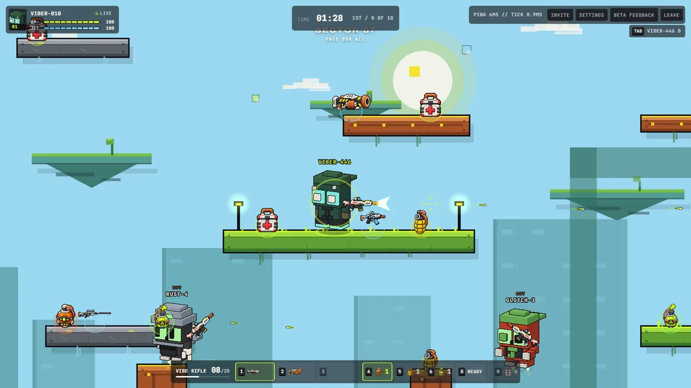</a>

</div>

## Gallery

Captures come from a local production build. The capture script places players and bots, grants a weapon and eliminates a bot in some scenes, so each scene repeats. The HUD and the rules are unchanged. The mobile shot is an emulated phone, not a physical device. Click any image for full size.

<table>
  <tr>
    <td width="50%" valign="top">
      <a href="docs/media/hub-overview.webp">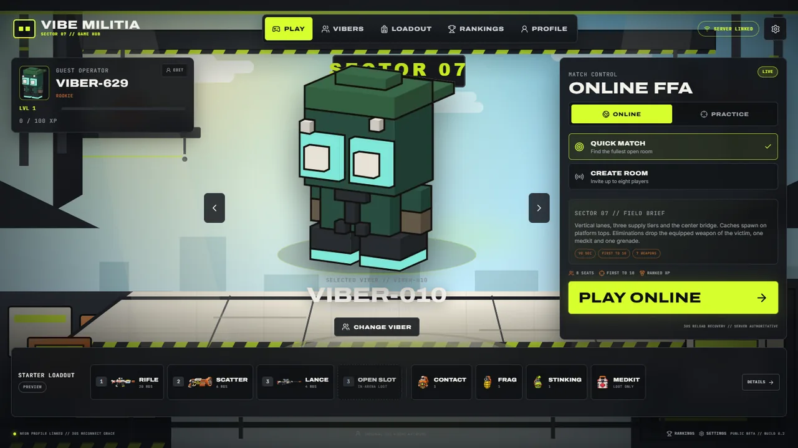</a><br>
      <sub><b>Game hub.</b> Pick your Viber, switch between Online and Practice, and check your starter loadout.</sub>
    </td>
    <td width="50%" valign="top">
      <a href="docs/media/character-roster.webp">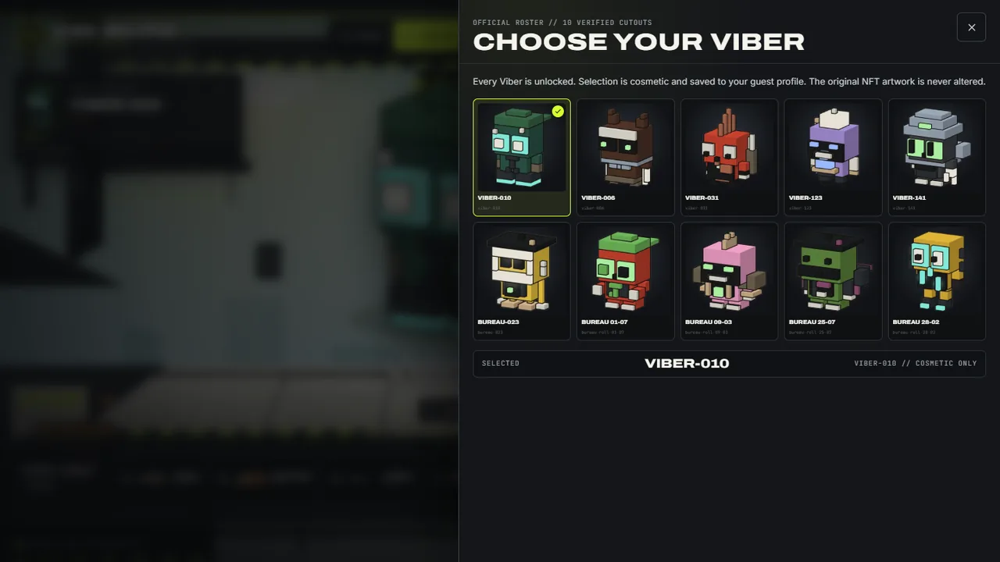</a><br>
      <sub><b>Official roster.</b> All ten Vibers are selectable. Selection is cosmetic.</sub>
    </td>
  </tr>
  <tr>
    <td width="50%" valign="top">
      <a href="docs/media/akimbo-rifles-combat.webp">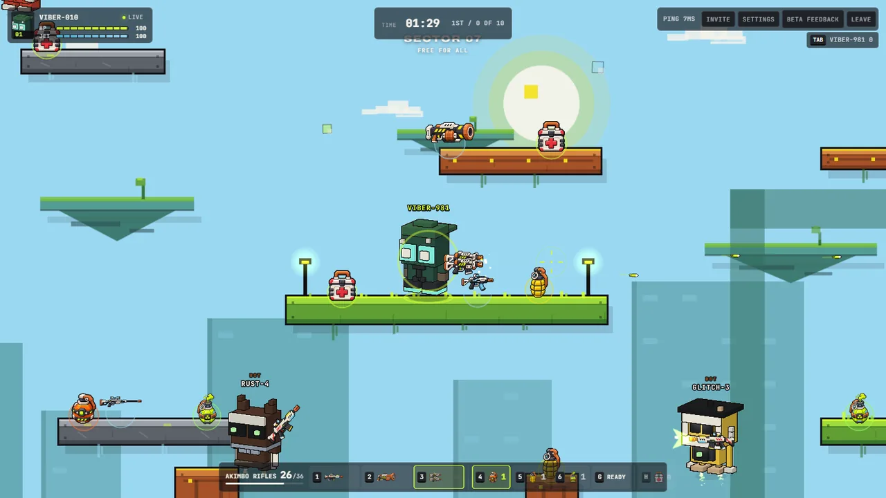</a><br>
      <sub><b>Akimbo Rifles.</b> Two barrels alternate shots from one shared 36-round magazine.</sub>
    </td>
    <td width="50%" valign="top">
      <a href="docs/media/stinking-grenade-cloud.webp">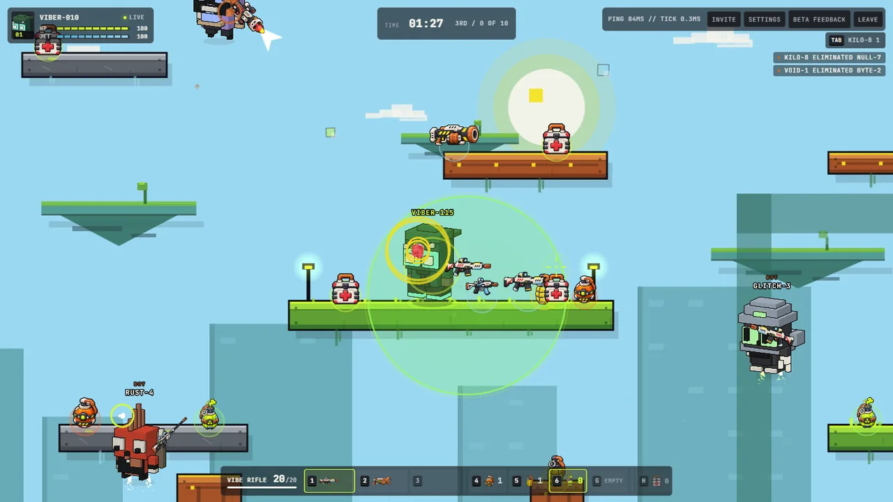</a><br>
      <sub><b>Stinking grenade.</b> A green toxic cloud that wears down anyone who stays inside.</sub>
    </td>
  </tr>
  <tr>
    <td width="50%" valign="top">
      <a href="docs/media/elimination-loot.webp">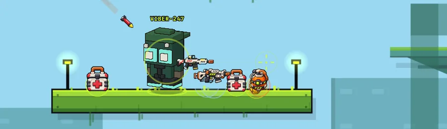</a><br>
      <sub><b>Elimination loot.</b> A fallen rival drops their weapon, a medkit and a grenade.</sub>
    </td>
    <td width="50%" valign="top">
      <a href="docs/media/match-results.webp">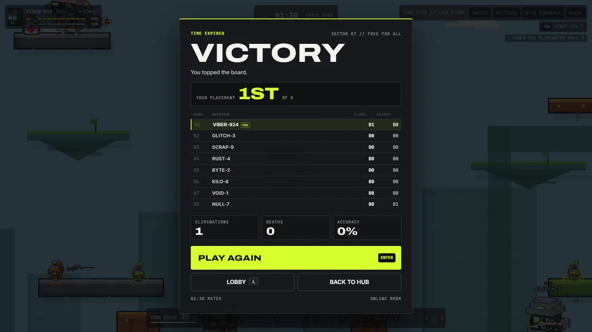</a><br>
      <sub><b>Results.</b> Placement, scoreboard and the choice to play again, return to the lobby or go back to the hub.</sub>
    </td>
  </tr>
  <tr>
    <td width="50%" valign="top">
      <a href="docs/media/practice-normal.webp">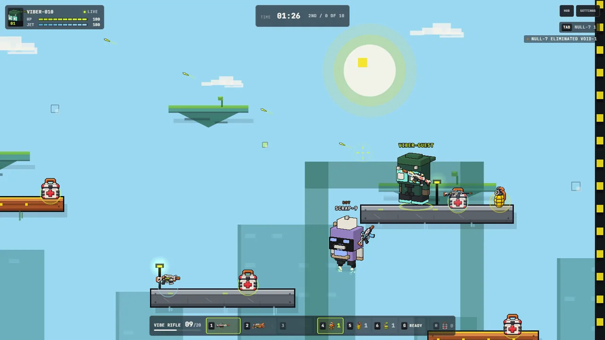</a><br>
      <sub><b>Practice against bots.</b> Seven bots at Normal, with the same rules as Online and no XP.</sub>
    </td>
    <td width="50%" valign="top">
      <a href="docs/media/mobile-landscape-controls.webp">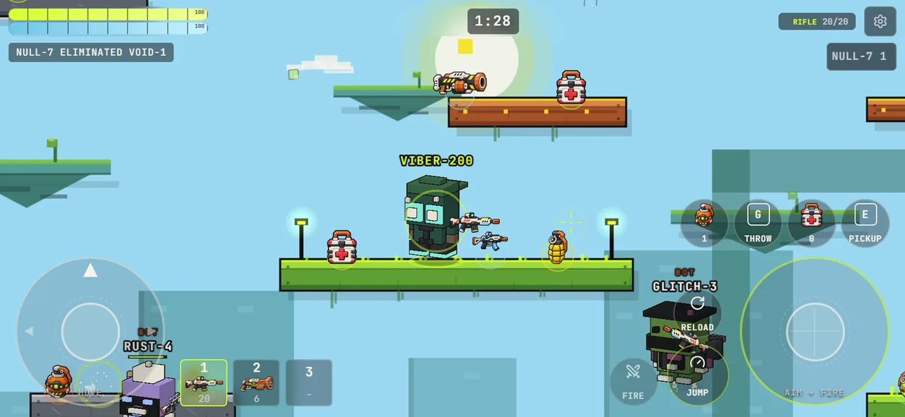</a><br>
      <sub><b>Mobile landscape.</b> Twin-stick controls on an emulated 844 by 390 phone.</sub>
    </td>
  </tr>
</table>

## What is Vibe Militia?

Vibe Militia is a side-view arena shooter. Every match runs 90 seconds in Sector 07, one arena of platforms, a center bridge and fourteen respawn pads. The match ends at ten eliminations or when the clock hits zero, and the top of the standings wins.

The feel is closer to the twin-stick, jetpack chaos of Mini Militia, the mobile shooter that inspired the touch controls. This project is not affiliated with or endorsed by that game or its publisher.

A typical run looks like this:

1. Pick a Viber in the hub. Every character is free to use.
2. Jump into Online (up to eight seats) or Practice (seven bots, four difficulty levels).
3. Run, jump and thrust. Hold Space in the air to burn jetpack fuel and climb.
4. Aim all the way around and fire. You carry three weapon slots and reload when a magazine runs dry.
5. Grab weapons, medkits and grenades from caches across the arena.
6. Eliminate a rival, then claim what they drop.
7. Earn XP, unlock titles, badges, elimination effects and jetpack trails, then replay or return to the hub.

## Game modes

### Online Free-for-All

- Rooms hold up to eight combatants. Humans and bots share the seats.
- Quick Match joins the fullest open room or creates a new one. Create Room gives you an invite link or a join code. Many rooms run at once, and each is independent.
- A new room waits for a countdown, 10 seconds by default, then fills empty seats with bots. Eight humans start immediately. A human who joins mid-countdown or mid-match takes over a bot seat without restarting the clock.
- The server owns movement, damage, ammo, grenades, loot, timers and scoring. Clients send inputs only.
- An eliminated player respawns after 2.8 seconds at a fair respawn pad with 1.5 seconds of spawn protection. Death resets the loadout to the starter set.
- Reconnect holds your seat for 30 seconds. Reloading the same tab recovers the same seat. A second tab cannot take a live seat.
- The results screen offers PLAY AGAIN, which replays the same room, LOBBY, and BACK TO HUB.

### Practice

- A local match of 90 seconds, first to ten eliminations, with you and seven bots.
- Four difficulties: Easy, Normal, Hard and Merciless. They change reaction time, fire cadence, burst size, aim error and grenade use. Easy bots do not throw grenades.
- Practice runs the same `GameSimulation` as online rooms, inside a Web Worker in your browser. It needs no network once the page has loaded.
- Practice has the same weapons, grenades, medkits, caches and loot. It has no profile, so it never earns XP or appears on the leaderboard.
- Link straight to a difficulty with `/practice?difficulty=normal` (or `easy`, `hard`, `merciless`).

## Weapons & Arsenal

You start with a Vibe Rifle in slot 1 and a Scatter Blaster in slot 2. Slot 3 is empty until you find a weapon. Every mode uses the same seven weapons, and each has its own ammo, cadence, reload and HUD slot. The numbers below come from `src/game/config/gameplay.ts`.

<table>
  <thead>
    <tr>
      <th align="left">Weapon</th>
      <th align="left">Damage</th>
      <th align="left">Pellets</th>
      <th align="left">Magazine</th>
      <th align="left">Fire interval</th>
      <th align="left">Reload</th>
      <th align="left">How you get it</th>
    </tr>
  </thead>
  <tbody>
    <tr>
      <td>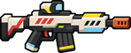<br><b>Vibe Rifle</b><br><sub>Full auto, mid range</sub></td>
      <td>14</td><td>1</td><td>20</td><td>108 ms</td><td>1100 ms</td><td>Starter, slot 1</td>
    </tr>
    <tr>
      <td>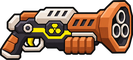<br><b>Scatter Blaster</b><br><sub>Break action, close range</sub></td>
      <td>9 per pellet</td><td>7</td><td>6</td><td>720 ms</td><td>1800 ms</td><td>Starter, slot 2</td>
    </tr>
    <tr>
      <td><br><b>Vibe Lance</b><br><sub>Precision, two shot</sub></td>
      <td>50</td><td>1</td><td>4</td><td>650 ms</td><td>1650 ms</td><td>Fixed cache</td>
    </tr>
    <tr>
      <td>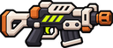<br><b>Akimbo Rifles</b><br><sub>Twin auto, shared magazine</sub></td>
      <td>10</td><td>1</td><td>36 shared</td><td>85 ms</td><td>1800 ms</td><td>Fixed cache</td>
    </tr>
    <tr>
      <td>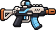<br><b>Vibe SMG</b><br><sub>Rapid auto, close range</sub></td>
      <td>8</td><td>1</td><td>30</td><td>70 ms</td><td>1250 ms</td><td>Fixed cache</td>
    </tr>
    <tr>
      <td>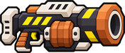<br><b>Heavy Cannon</b><br><sub>Slow slug, high impact</sub></td>
      <td>60</td><td>1</td><td>5</td><td>900 ms</td><td>2100 ms</td><td>One per room, contested</td>
    </tr>
    <tr>
      <td>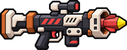<br><b>Rocket Launcher</b><br><sub>Blast, self danger</sub></td>
      <td>120 at the center, 40 at the edge of a 180 px blast</td><td>1 rocket</td><td>3</td><td>1100 ms</td><td>2400 ms</td><td>One per room, contested</td>
    </tr>
  </tbody>
</table>

Notes on the numbers:

- **Scatter Blaster** deals 9 damage per pellet. A shot where all seven pellets land deals up to 63. Real damage depends on range and spread.
- **Rocket Launcher** has no separate direct-hit damage. The explosion does all the work. A target at the center takes 120, the falloff runs to a 40 minimum at 180 px, and the rocket can hurt you too. Each explosion hits each combatant once.
- **Akimbo Rifles** alternate between two visible barrels on each shot. The 36 rounds are one shared magazine, not 36 per barrel.
- **Vibe Lance** needs two hits from a full-health Viber.
- **Heavy Cannon** and **Rocket Launcher** appear once per room on contested elevated routes. Their rounds are scarce, so pick your fights.

Weapon art lives in `public/sprites/loadout/`, and the HUD icons live in `public/sprites/icons/`.

## Grenades & Explosives

Each grenade has its own throw, fuse and effect. Stats come from `src/game/core/grenades.ts` and the authoritative simulation.

<table>
  <thead>
    <tr>
      <th align="left">Grenade</th>
      <th align="left">Behavior</th>
      <th align="left">Effect</th>
      <th align="left">Throw</th>
    </tr>
  </thead>
  <tbody>
    <tr>
      <td>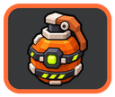<br><b>Contact</b></td>
      <td>Detonates on impact with terrain or a combatant. Arms 100 ms and 18 px after the throw.</td>
      <td>Blast: 180 max, 10 min, 220 px radius, falloff exponent 1.25.</td>
      <td>Speed 920, gravity 1500, bounce 0.18</td>
    </tr>
    <tr>
      <td>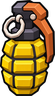<br><b>Frag</b></td>
      <td>Bounces off terrain and detonates when its server-owned 5 second fuse runs out.</td>
      <td>Blast: 120 max, 6 min, 215 px radius, falloff exponent 1.2.</td>
      <td>Speed 820, gravity 1400, bounce 0.5</td>
    </tr>
    <tr>
      <td>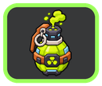<br><b>Stinking</b></td>
      <td>Bounces, then releases a toxic cloud 900 ms after the throw.</td>
      <td>Cloud: 160 px radius, lasts 6 s, 24 HP per second in 6 HP ticks every 250 ms.</td>
      <td>Speed 760, gravity 1400, bounce 0.45</td>
    </tr>
  </tbody>
</table>

Rules that apply to all three:

- You carry at most three grenades in total. You start with one of each. A grenade cache adds one grenade of its type.
- Select with `4`, `5`, `6` (or the touch selector). Throw with `G` or THROW. Throws have a 700 ms cooldown.
- An explosion damages each combatant at most once. Blast damage is multiplied by 0.45 behind solid cover, so cover cuts it by 55 percent.
- Grenades can hurt you. Self-damage counts as a death but never gives an opponent a kill.
- A room tracks up to 64 active grenades at a time.

**How grenade damage differs from bullets.** A bullet deals a fixed amount when it hits. A grenade deals area damage that falls off with distance, so being close matters more than a clean hit. The explosion also ignores weapon spread and accuracy. Stinking grenades are the exception: they deal damage over time while a target stays inside the cloud.

**Stinking cloud rules.** Overlapping clouds do not stack. A combatant inside several clouds takes damage from the closest one only, with the lower cloud ID breaking ties. Solid terrain blocks cloud damage completely. The room caps active clouds at 24. Toxic damage is credited to the cloud's owner in the kill feed, even if that owner has since disconnected.

## Items, supplies & elimination loot

<table>
  <tr>
    <td align="center" width="25%">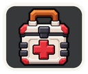<br><b>Medkit</b></td>
    <td align="center" width="25%"><br><b>Grenade cache</b></td>
    <td align="center" width="25%"><br><b>Weapon cache</b></td>
    <td align="center" width="25%"><br><b>Contested weapon</b></td>
  </tr>
</table>

**Medkits** heal 50 HP and cannot push you above 100. You carry up to two. There is a 900 ms cooldown between uses. Press `H` or the medkit button. Carried medkits are lost on death.

**Caches** are fixed on platform tops. Sector 07 has 31 of them: 14 medkits, 3 contact grenades, 3 frag grenades, 3 stinking grenades, 2 Vibe Lances, 2 Akimbo Rifles, 2 Vibe SMGs, 1 Heavy Cannon and 1 Rocket Launcher. Medkits respawn after 20 seconds, grenades after 22 seconds, and weapons after 25 seconds.

**The three-slot weapon inventory** works like this:

- An empty slot takes a new weapon automatically.
- A weapon you already own refills one full magazine on your copy. You never hold two of the same gun.
- With all three slots full, walking over a new weapon leaves it on the ground. Press `E` to swap it into your equipped slot. The replaced weapon is removed, not dropped, so swapping cannot duplicate a gun.
- Switch slots with `1`, `2`, `3` or the weapon buttons.

**Elimination loot** is how weapons move between players. Each hostile elimination, human or bot, drops exactly three items:

1. The victim's equipped weapon, with its current magazine.
2. One medkit.
3. One grenade. This is the type the victim carried most. Ties and empty inventories default to contact.

Drops settle on the nearest platform below the death point. They last 12 seconds and disappear when they expire. Walk close to collect. A room holds up to 48 loot items, and the oldest go first when it fills. Self-eliminations and duplicate deaths drop nothing. All loot clears when a match starts, ends or replays.

**Bots** use the same supply rules. They collect nearby caches and medkits, use a medkit when below 55 HP, throw grenades on a 9 to 14 second decision cooldown when a target is in range and in line of sight, and move away from toxic clouds. Curious bots can also pick up an advanced weapon. Bots do not coordinate routes, and they are not perfect.

## Meet the Vibers

<table>
  <tr>
    <td align="center">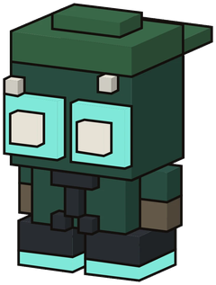<br><b>VIBER-010</b><br><sub>Default</sub></td>
    <td align="center">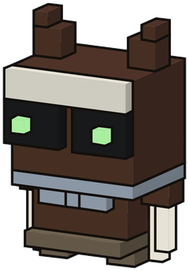<br><b>VIBER-006</b></td>
    <td align="center">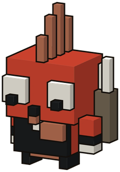<br><b>VIBER-031</b></td>
    <td align="center">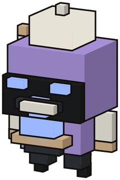<br><b>VIBER-123</b></td>
    <td align="center">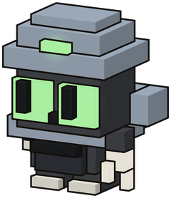<br><b>VIBER-141</b></td>
  </tr>
  <tr>
    <td align="center">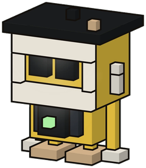<br><b>BUREAU-023</b></td>
    <td align="center">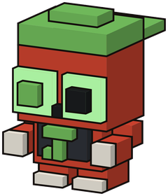<br><b>BUREAU 01-07</b></td>
    <td align="center">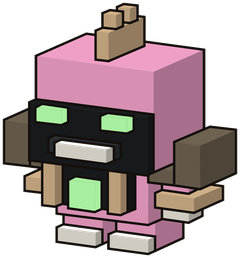<br><b>BUREAU 09-03</b></td>
    <td align="center">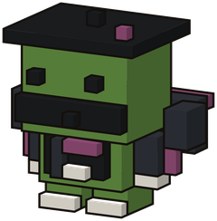<br><b>BUREAU 25-07</b></td>
    <td align="center">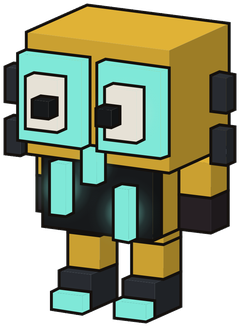<br><b>BUREAU 28-02</b></td>
  </tr>
</table>

All ten are selectable now. You need no NFT wallet, account or payment. Your choice changes your in-world sprite and your HUD portrait. It never changes health, damage, speed or weapons. The artwork comes from the original Vibe Vibers collection and is shown as delivered, not regenerated or restyled. Two players can pick the same Viber, and bots avoid duplicates where they can.

## Controls

### Desktop

| Action | Input |
| --- | --- |
| Move | `A` / `D` or Left / Right arrows |
| Jump | `Space` |
| Jetpack thrust | Hold `Space` in the air. Fuel drains while thrusting and refills once you stop. |
| Aim | Mouse pointer. Aim covers the full 360 degrees. |
| Fire | Hold left mouse button |
| Reload | `R` |
| Weapon slots | `1`, `2`, `3` |
| Select grenade | `4` contact, `5` frag, `6` stinking |
| Throw grenade | `G` |
| Use medkit | `H` |
| Pick up or swap nearby loot | `E`. With a full loadout, `E` replaces your equipped weapon. |
| Scoreboard | Hold `Tab` |
| Leave the match | `LEAVE` in the online HUD, or `BACK TO HUB` in Practice. The results screen offers `LOBBY` (`L`), `BACK TO HUB` and `PLAY AGAIN` (`Enter`). |

### Mobile (landscape)

Mobile play uses a twin-stick layout in landscape. Portrait shows a rotation prompt instead of controls.

| Control | What it does |
| --- | --- |
| Left pad (MOVE) | Drag left or right to run. Push up to thrust the jetpack. |
| Right pad (AIM + FIRE) | A thumb on the pad fires. A quick tap fires at the aim you already have. Drag, or hold for 140 ms, to set the aim to where your thumb points. Releasing stops fire and keeps the aim. |
| FIRE button | Available as a separate fire button when combined aim and fire is turned off in settings. |
| JUMP | Jump and jetpack. |
| RELOAD | Reload the equipped weapon. |
| Weapon slots `1` `2` `3` | Tap to equip. |
| Grenade selector and THROW | Pick a grenade type, then throw it. |
| Medkit | Use one carried medkit. |
| PICKUP | Pick up or swap nearby loot. |
| Settings (gear) | Move dead zone, aim dead zone, fly threshold, combined aim and fire on or off, and fullscreen. |
| Hub | Return to the hub. |

## Progression, leaderboard & profiles

**Guest identity.** Your browser gets a guest token on first visit. The server keeps only a SHA-256 hash of it. The profile is device-bound. Clearing site data removes access to it. There are no accounts, wallets or passwords.

**Names.** Display names are editable and not unique. The first-visit prompt also offers an optional X handle. The handle is self-declared, is never verified, and appears publicly only when you switch that on.

**Leaderboard.** `GET /api/leaderboard` returns the all-time board, using XP, wins and K/D from server records. The first-visit prompt has "Include me in the global leaderboard" ticked by default. Untick it to stay off the board.

**XP sources** (`src/game/progression/progression.ts`):

| Source | XP | Cap |
| --- | --- | --- |
| Match completed | 30 | Once per match |
| Human elimination | 10 each | 80 |
| Bot elimination | 5 each | 40 |
| Placement 1st, 2nd, 3rd | 25, 15, 10 | Once per match |

A match gives at most 200 XP. It counts only if you completed it, spent at least 45 seconds in it, and sent at least 20 inputs. Practice gives no XP.

**Levels.** Level 2 needs 100 XP. Each further level needs 50 XP more than the last. The cap is level 50, which takes 63,700 XP in total.

**Unlocks** are cosmetic. They never change combat.

| Level | Unlocks |
| --- | --- |
| 1 | Title ROOKIE, badge LIME RECRUIT, elimination effect LIME BURST, trail LIME EXHAUST |
| 2 | Title DROP READY |
| 3 | Title FIELD TESTED |
| 4 | Elimination effect COPPER SHATTER |
| 5 | Badge COPPER STRIKE |
| 6 | Title VIBE VETERAN, trail COPPER COMET |
| 7 | Elimination effect TOXIC POP |
| 8 | Badge SKY RUNNER |
| 9 | Trail SKY STREAK |
| 10 | Title SECTOR LEGEND |
| 12 | Badge SECTOR ICON |

The profile also stores matches, wins, losses, eliminations, deaths, per-weapon stats, recent matches and equipped cosmetics.

**Limits.** There is no account recovery, no X ownership check and no way to move a profile between devices yet.

## Technical architecture

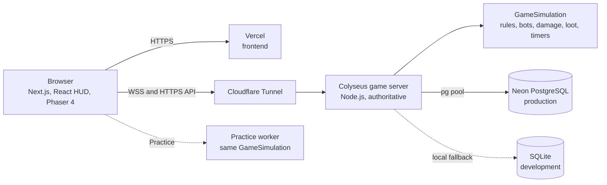

| Layer | Technology | Where it runs |
| --- | --- | --- |
| Frontend | Next.js 16, React 19, TypeScript, Tailwind v4 | Vercel, and your browser |
| Renderer | Phaser 4 scenes, with React HUD reading a typed snapshot bridge | Your browser |
| Multiplayer | Colyseus 0.18 rooms, 60 Hz server tick, 20 Hz snapshots | Persistent Node.js process |
| Shared rules | Movement and combat in `src/game/core` and `src/game/multiplayer`, with no Phaser imports | Server and browser |
| Practice | `GameSimulation` in a Web Worker | Your browser |
| Persistence | Neon PostgreSQL in production, SQLite fallback for local development | Server |
| Edge | Cloudflare Tunnel for HTTPS and WSS to the game server | Edge |

**Client-side:** rendering, camera, audio, the HUD, input capture and movement prediction. The client sends inputs only. It never reports positions or hits.

**Server-authoritative:** movement, collisions, health, ammo, projectiles, grenades, toxic clouds, bots, pickups, loot, timers, scoring, elimination credit, respawns and XP settlement.

**Netcode.** The server applies one client tick per server tick and holds any player whose input is late. Clients predict their own movement and reconcile against the authoritative state. Remote players interpolate from a buffer of snapshots. Muzzle flash and sound play immediately, then match against the server's `shot` events.

## Getting started

**Prerequisites**

- Node.js 24 and npm
- Google Chrome, for the browser verification scripts, which launch it through `playwright-core`
- Python 3, only if you regenerate character cutouts with `scripts/prepare_character.py`

**Install and run locally**

```bash
npm install
npm run server:dev
```

In a second terminal:

```bash
npm run dev
```

Then open:

- `http://localhost:3000` for the hub
- `http://localhost:3000/practice?difficulty=normal` for Practice
- `http://localhost:3000/online` for Online matches

Online matches need the game server on port 2567. The Next.js client reads `NEXT_PUBLIC_GAME_SERVER_URL` at build time.

**Environment variables.** Copy `.env.example` to `.env.local` and fill in only what you need. Leave `DATABASE_URL` blank to use SQLite at `DATABASE_PATH`. Never commit `.env.local`, and never put database credentials or tokens in source files.

**Production build**

```bash
npm run build
npm run server:start
npm start
```

For production hosting, see [DEPLOYMENT.md](DEPLOYMENT.md). For the beta plan, see [BETA_TESTING.md](BETA_TESTING.md).

**Unit tests, types and lint**

```bash
npm run typecheck
npm run lint
npm test
```

**Browser verification.** These scripts boot their own disposable SQLite stack, so they cannot write to a real database:

```bash
node scripts/build-test-frontend.mjs
npm run verify:playability
npm run verify:mobile
node scripts/run-regressions.mjs
```

Most online suites, such as `npm run verify:online:matchmaking`, expect the frontend and game server to be running. The scripts folder has the full list.

**Regenerate the README gallery**

```bash
node scripts/build-test-frontend.mjs
node scripts/capture-readme-media.mjs
python scripts/optimize-readme-media.py
```

## Project status

- The public beta is live on [vibemilitia.vercel.app](https://vibemilitia.vercel.app), with the game server behind a tunnel.
- The planned 15 to 20 player beta from [BETA_TESTING.md](BETA_TESTING.md) has not run yet.
- Mobile behavior is verified in emulated Chromium only. Physical iOS and Android testing is still to do, and iOS Safari is unverified.

## Known limitations

- Guest profiles are device-bound. Clearing browser storage loses them.
- X handles are self-declared and unverified.
- Live rooms and reconnect tokens live in server memory. A game-server restart returns players to the lobby.
- There is no lag compensation. Players far from the server feel the extra latency.
- A reload recovers your seat in the same tab. Characters can be changed only in the lobby, not during a match.
- Sector 07 is the only arena.
- Audio is original synthesized sound only. There is no music or voice.
- No gamepad support and no key remapping.

## Privacy

- The game stores a guest token in your browser and only a hash on the server.
- Beta feedback records your message, rating, page route and app version. It can include your guest ID. Client error reports are anonymous. Neither one stores an IP address or a user-agent string.
- Your display name and any X handle appear on the leaderboard only while the leaderboard option stays on.
- The browser keeps a short-lived, tab-scoped reconnect handle in session storage. It is not shared between tabs.

## Contributing & bug reports

- Report bugs and request features in [GitHub Issues](https://github.com/Devendurance/vibemilitia/issues). Include your browser, device, what you expected and what happened. Do not include tokens or personal details.
- Gameplay rules belong in `src/game/core` or `src/game/multiplayer`, not in the Phaser scenes. Keep the server authoritative.
- Run the typecheck, lint and test commands above before you open a change.
- Code contributions are accepted under the MIT License. Do not add artwork, sprites or other assets without confirmed rights. See the licensing section below.

## Licensing & asset rights

- **Source code.** The original source code is licensed under the [MIT License](LICENSE).
- **Artwork is not covered by the MIT License.** The ten Vibe Vibers character images and their derived cutouts, plus the sprite art, icons and Sector 07 brand art, carry their own rights status. The MIT grant does not extend to them. See [ASSET_RIGHTS.md](ASSET_RIGHTS.md) for provenance and what is still unverified.
- **Third-party software.** Dependencies such as Phaser, Next.js, React and Colyseus keep their own licenses. See `package-lock.json` and each package's license file.
- **Names and trademarks.** Mini Militia is named only as an inspiration. Vibe Vibers and its collection names belong to their owners.

## Credits

- Character artwork from the original Vibe Vibers collection. The rights status is in [ASSET_RIGHTS.md](ASSET_RIGHTS.md).
- Built with [Phaser](https://github.com/phaserjs/phaser), [Next.js](https://nextjs.org), [React](https://react.dev), [TypeScript](https://www.typescriptlang.org), [Colyseus](https://colyseus.io), [Neon](https://neon.tech), [Vercel](https://vercel.com) and [Cloudflare Tunnel](https://www.cloudflare.com/products/tunnel/).
- Gameplay inspired by Mini Militia. This project is not affiliated with it.
